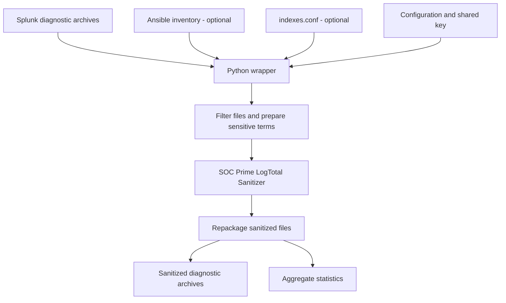

# Splunk Diag Sanitizer

A lightweight Python wrapper around [SOC Prime's LogTotal Sanitizer](https://github.com/socprime/logtotal-sanitizer) for sanitizing Splunk diagnostic bundles before sharing them with external support teams.

The tool replaces sensitive infrastructure identifiers and credentials while retaining useful troubleshooting context. It supports individual diagnostics and batches from distributed Splunk environments, with optional Ansible inventory and index name discovery.

> **Status:** Prototype (v0.8). Wrapper tests use a mock sanitizer; compatibility with the actual upstream CLI must be validated before production use. Review all sanitized data before external release.

## Features

- Process `.tar.gz` and `.tgz` diagnostic archives without manually extracting them.
- Sanitize logs, configuration files and archive member paths.
- Use deterministic pseudonyms to correlate matching values across diagnostic bundles.
- Import known hostnames and DNS domains from Ansible inventories.
- Import custom Splunk index names from `indexes.conf`, excluding common default indexes.
- Filter out sensitive files, unsupported file types and unnecessary archive contents.
- Process multiple diagnostics in one execution with a live progress indicator.
- Generate individual sanitization reports and an aggregate batch report.

## How it works



| SOC Prime LogTotal Sanitizer | Splunk Diag Sanitizer wrapper |
| --- | --- |
| IP, hostname, user and secret detection | Splunk diagnostic archive processing |
| Deterministic HMAC-based pseudonymization | File filtering and archive path handling |
| Native detection rules and custom sensitive terms | Ansible inventory, DNS domain and index discovery |
| Configurable detection categories | Batch orchestration and progress reporting |
| Sanitization statistics | Aggregate reports without original-value mappings |

The wrapper does not fork SOC Prime or implement its own anonymization engine. All sensitive-value replacement is delegated to the locally installed upstream CLI.

For example, a log entry such as:

```text
ERROR TcpOutputProc - Connection to 10.20.30.15:9997 failed
```

may become:

```text
ERROR TcpOutputProc - Connection to <IP:a7f2b3c91d0246e7>:9997 failed
```

The token is illustrative. Actual replacements depend on the upstream rules and key. Identical values matched by the same rule with the same key produce consistent pseudonyms; different aliases or matching rules may produce different tokens.

## Installation

### Requirements

- Python 3.10 or newer (no third-party Python packages required)
- Node.js 20 or newer and npm
- Bash for the installer
- Ansible (optional; required only for native inventory resolution)

From the repository root, run:

```bash
chmod +x install.sh
./install.sh
```

The installer checks prerequisites, installs SOC Prime locally under `node_modules/` and creates `anonymization.key` with restrictive permissions. No sudo or global npm installation is required. If a key already exists, the installer asks before proceeding and preserves the existing key by default. Rotation requires explicit confirmation.

To install an approved upstream release, replace `VERSION` with the selected version:

```bash
./install.sh --version VERSION
```

Installation requires access to npm or an approved package mirror. Sanitization itself runs locally. For repeatable deployments, retain the generated `package-lock.json` and use `npm ci`.

## Quick start

Generate a diagnostic on a Splunk instance:

```bash
/opt/splunk/bin/splunk diag
```

Securely transfer the archive to the workstation or Ansible controller running the sanitizer. Run the following examples from the repository root.

### Sanitize a single diagnostic

```bash
python3 sanitize_diag.py original.tar.gz sanitized.tar.gz \
  --cli ./node_modules/.bin/logtotal-sanitize \
  --key-file anonymization.key \
  --config config.json
```

This creates `sanitized.tar.gz` and `sanitized.tar.gz.json`. The original archive remains unchanged.

### Sanitize multiple diagnostics

Process every `.tar.gz` or `.tgz` archive in a directory:

```bash
python3 sanitize_diag.py --input-dir ./diags --output-dir ./sanitized \
  --cli ./node_modules/.bin/logtotal-sanitize \
  --key-file anonymization.key \
  --config config.json
```

Or select the archives explicitly:

```bash
python3 sanitize_diag.py --input cm.tar.gz idx01.tar.gz sh01.tar.gz \
  --output-dir ./sanitized-case-123 \
  --cli ./node_modules/.bin/logtotal-sanitize \
  --key-file anonymization.key \
  --config config.json
```

Directory discovery is nonrecursive and sorted by filename. Explicit inputs retain their supplied order. Batch mode loads the key and sanitization policy once and processes archives sequentially. Output names are neutral and numbered:

```text
sanitized/
├── diag-0001.tar.gz
├── diag-0001.tar.gz.json
├── diag-0002.tar.gz
├── diag-0002.tar.gz.json
└── batch-report.json
```

Use a fresh output directory for each run: existing outputs are never overwritten. A batch stops on the first failure; completed archives remain available but must not be released without review.

## Improve detection with infrastructure discovery

SOC Prime detects sensitive values using its native rules. Optional discovery adds known organization-specific identifiers to its sensitive-term dictionary, helping detect short hostnames and custom index names that generic rules may miss.

### Ansible inventory

Add `-i inventory/production.yml` to any execution command to import inventory hostnames, connection hostnames, short names and available hostname facts. Multiple `-i` options are supported, as are repeated `--vault-id` options for inventory resolution.

For a restricted environment, export the inventory on the controller:

```bash
umask 077
ansible-inventory -i inventory/production.yml --list > inventory-export.json
```

Use `--inventory-json inventory-export.json` instead of `-i`. Treat the export as sensitive: it may contain credentials. No remote fact gathering is performed; dynamic inventory plugins may contact external services.

### Splunk index names

Export the effective configuration on an indexer, without `--debug`:

```bash
umask 077
/opt/splunk/bin/splunk btool indexes list > indexes.conf
```

Transfer the file securely to the sanitizer host and add `--indexes-conf indexes.conf` to the command. Multiple exports can be provided by repeating the option.

Only index stanza names are imported. The wrapper ignores `main`, `summary`, `history`, internal names starting with `_`, `[default]` and special stanzas such as `[volume:hot]`. Add generic custom index names to `index_exclusions` to avoid excessive masking.

### Combined example

```bash
python3 sanitize_diag.py --input-dir ./diags --output-dir ./sanitized-case-456 \
  --cli ./node_modules/.bin/logtotal-sanitize \
  --key-file anonymization.key \
  --config config.json \
  --inventory-json inventory-export.json \
  --indexes-conf indexes.conf
```

Discovery is optional, not a prerequisite for deterministic replacements. Use the same key, upstream release, rules, inventory snapshot and index export for all diagnostics in a support case.

## Configuration

The supplied `config.json` defines the sanitization policy. Edit it to suit your environment.

| Setting | Purpose |
| --- | --- |
| `rules` | Enabled upstream detection categories. Defaults to `secrets`, `sessionCookies`, `ips`, `hosts`, `users`, `paths`. |
| `aggressive` | Enable more extensive upstream detection (default: `false`). |
| `sensitive_terms` | Additional literal values, such as project names or service identifiers. |
| `domains` | Known DNS suffixes; use literal domains, not wildcards. |
| `inventory_hostname_vars` | Additional inventory variables containing hostnames. |
| `inventory_discover_domains` | Automatically discover DNS suffixes from inventory (default: `false`). |
| `inventory_domain_vars` | Additional variables containing DNS domains. |
| `inventory_domain_exclusions` | Domains excluded from automatic discovery, including descendants. |
| `include_extensions` | File extensions eligible for sanitization (default: `.log`, `.conf`). |
| `index_exclusions` | Extra index names excluded from index discovery. |

For example, these settings can be added or updated in the supplied JSON configuration:

```json
{
  "sensitive_terms": ["INTERNAL_PROJECT_NAME"],
  "domains": ["internal.example.com"],
  "inventory_discover_domains": true,
  "inventory_domain_exclusions": ["splunk.com", "microsoft.com", "amazonaws.com"],
  "include_extensions": [".log", ".conf"],
  "index_exclusions": ["network", "windows"]
}
```

A configured domain also targets descendant subdomains. Automatic discovery avoids redundant discovered suffixes when a parent already covers them. Discovery exclusions are not global allowlists. Custom terms, domain rules and native rules may overlap; upstream matching precedence determines the actual replacement.

### File filtering

By default, the wrapper includes `.log`, `.conf` and uncompressed numbered log rotations such as `splunkd.log.1`. Other files are omitted, not copied unchanged.

Security exclusions take precedence, including known credential files (`splunk.secret`, `passwd`, `passwords.conf`, `authentication.conf`, `user-seed.conf`), certificate/key formats, selected database and dispatch directories, links, nested archives and unsupported binary or encoded files. This means compressed log rotations are not included.

You can explicitly extend `include_extensions` with types such as `.txt` or `.csv` when needed. The resulting archive is a reduced diagnostic, not necessarily a drop-in replacement for a complete Splunk diag.

## Progress and reports

An interactive terminal displays an in-place progress line showing the current diagnostic, completed diagnostics, eligible file count, percentage and exclusions. For example:

```text
[272.0s] Diag 3/5 | Done 2/5 | [#############-------] 67.2% 168/250 target files | OK 168 Skip 42
```

Use `--progress-interval 5` to update every five seconds or `--quiet` to suppress progress. Redirected output uses plain-text status messages. Reports contain aggregate rule counts, file exclusions and discovery statistics rather than original-to-token mappings. Inspect them to identify omissions and processing failures.

For the full CLI reference, run:

```bash
python3 sanitize_diag.py --help
```

## Ansible automation

Generate diagnostics on the Splunk hosts, transfer them using `ansible.builtin.fetch` into a private, dedicated directory on the controller, and invoke batch mode once all transfers finish. For example, with the paths defined in your playbook variables:

```yaml
- name: Sanitize all collected diagnostics
  ansible.builtin.command:
    argv:
      - python3
      - "{{ diag_anonymizer_home }}/sanitize_diag.py"
      - --input-dir
      - "{{ diag_input_dir }}"
      - --output-dir
      - "{{ diag_sanitized_dir }}"
      - --cli
      - "{{ diag_anonymizer_home }}/node_modules/.bin/logtotal-sanitize"
      - --key-file
      - "{{ diag_anonymizer_home }}/anonymization.key"
      - --config
      - "{{ diag_anonymizer_home }}/config.json"
      - --inventory-json
      - "{{ diag_inventory_export }}"
      - --indexes-conf
      - "{{ diag_indexes_conf }}"
  delegate_to: localhost
  become: false
  run_once: true
  no_log: true
```

Run this task after collection with the linear strategy and no `serial`, or in a separate controller play. With `serial`, `run_once` runs per batch. If using `--limit`, ensure a separate controller play is not excluded. Ansible captures command output rather than displaying the interactive progress bar live.

## Security and limitations

- Keep the key, original archives, inventory exports and index exports private. Never commit or distribute them. Reuse a key within a support case; rotate it between unrelated cases as appropriate.
- Use a trusted encrypted workstation and private output directories. Temporary files may contain raw log data and upstream replacement reports; cleanup is not secure erasure.
- Pseudonymization does not guarantee irreversible anonymization. Tokens may change with matching context, and replacements may alter IP, DNS or configuration syntax.
- Default resource limits are 64 MiB per file, 4096 MiB of eligible text per archive, 50,000 archive members and 180 seconds per upstream invocation. See `--help` for overrides. A new upstream process is launched for each eligible file and uncached path component.
- No independent residual-data scanner is implemented. Detection rules and exclusions are not exhaustive. Review sanitized content, filenames and reports before sharing; zero reported matches does not establish safety.

## Testing

```bash
python3 -m unittest discover -s tests -v
```

The wrapper's ten local tests cover archive processing, filtering, discovery, progress and batch behavior with a mock CLI. Actual upstream installation and end-to-end integration were not verified in the development environment. Validate the selected SOC Prime release using synthetic diagnostics, including custom terms, domain rules, cross-bundle consistency and failure handling, before processing real data for release.

## Acknowledgments

The sanitization engine is provided by [SOC Prime LogTotal Sanitizer](https://github.com/socprime/logtotal-sanitizer). This project is an independent Splunk-specific orchestration wrapper, not an official SOC Prime or Splunk product.
